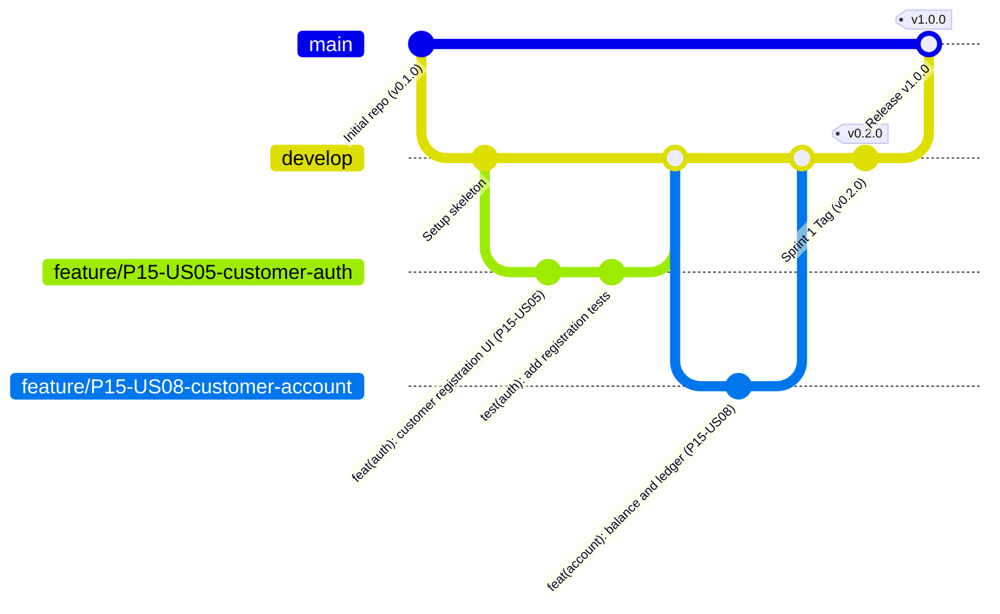

# PortfolioPro — AI Agents & Developer Governance Standard (AGENTS.md)

## 1. Purpose & Scope

This document serves as the permanent, authoritative engineering standard and operational handbook for all AI coding agents, contributors, and developers working on **PortfolioPro - Advanced Stock Trading and Portfolio Management Application** (Project Code: `P15`).

All future modifications, additions, or implementations must strictly adhere to the rules, architectural patterns, and conventions defined herein.

---

## 2. Core Commandments & Guardrails

1. **Academic Integrity & Traceability**:
   - Maintain 100% fidelity to the official ABES Engineering College / HCLTech project workbook (`guide_portfolioHCL.pdf` and `guide2HCL.pdf`).
   - **Never alter or omit story IDs** (`P15-US01` through `P15-US37`).
   - **Never delete or overwrite existing documentation or source files** unless explicitly instructed by the project owner.
2. **No Unwarranted Inventions**:
   - Do not invent requirements where the guide is ambiguous. Document ambiguities in `REQUIREMENTS.md` and seek explicit user architectural decisions before implementation.
3. **Decoupled Modern Architecture**:
   - Strict separation between Frontend (`frontend/` React SPA), Backend (`backend/` Django REST API), and Database (`database/` Supabase PostgreSQL). No monolithic server-rendered HTML templates.
4. **Financial Accuracy & Precision**:
   - **Never use floating-point types (`float`) for monetary amounts.**
   - All currency values, prices, fees, and P&L calculations must utilize Python `Decimal` and PostgreSQL `DECIMAL(18, 4)` / `NUMERIC(18, 4)`.
   - All monetary values presented on the UI must adhere to the Indian Rupee numbering format (`₹ 1,23,456.78`).
5. **Atomic Financial Consistency**:
   - Every order execution, fund deposit, fund withdrawal, and portfolio position update must be wrapped in Django's `@transaction.atomic` with balance locking to prevent race conditions or partial state persistence.

---

## 3. Technology Stack & Deployment Mandate

| Tier | Mandated Technology | Version / Tooling | Deployment Target |
| :--- | :--- | :--- | :--- |
| **Frontend** | React SPA | React 18, Vite 5, Bootstrap 5.3, Bootstrap Icons, Lucide-React, Axios, React Router v6, Chart.js / Recharts | **Netlify** (Global Edge CDN with SPA redirect rules) |
| **Backend** | Python / Django REST | Python 3.11/3.13, Django 5.x / 4.2 LTS, Django REST Framework, SimpleJWT, `drf-spectacular`, `pytest-django`, `gunicorn` | **Render** (Cloud Web Service) |
| **Database** | Managed PostgreSQL | **Supabase PostgreSQL 15+** (Migrated from legacy MySQL 8.0 specification; connection pooled via Supavisor on port 6543) | **Supabase Cloud** |
| **Repository** | Version Control | GitHub (`mca2-fsdpython-portfoliopro`) | **GitHub** |
| **API Spec** | OpenAPI 3.0 / Swagger | `drf-spectacular` interactive documentation at `/api/docs/` and Postman collections | `docs/api/` |

---

## 4. Standard Project Directory Structure

The repository must strictly adhere to the layout below (derived from Table 6 of `guide_portfolioHCL.pdf`):

```
PortfolioPro/
│
├── backend/                              # Django Backend Application Root
│   ├── manage.py                         # Django execution utility
│   ├── requirements.txt                  # Python production & development dependencies
│   ├── .env.example                      # Template for backend environment variables
│   │
│   ├── portfoliopro/                     # Project configuration package
│   │   ├── __init__.py
│   │   ├── settings.py                   # Modular settings (database, JWT, CORS, DRF)
│   │   ├── urls.py                       # Root URL routing configuration
│   │   └── wsgi.py                       # WSGI entry point for Gunicorn / Render
│   │
│   └── apps/                             # Modular Django domain applications
│       ├── authentication/               # Module 01: Custom User, Profile, JWT auth
│       ├── accounts/                     # Module 02: Trading account, Cash ledger, KYC
│       ├── market/                       # Module 03: Security master, Quotes, Watchlist
│       ├── trading/                      # Module 04: Order placement, Execution engine
│       ├── portfolio/                    # Module 05: Holdings, P&L calculations, Snapshots
│       ├── risk/                         # Module 06: Beta, Sharpe, VaR 95%, Concentration
│       ├── technical/                    # Module 07: RSI, MACD, SMA/EMA algorithms
│       ├── fundamental/                  # Module 08: P/E, EPS, Balance sheet, Peer matrix
│       ├── notifications/                # Module 09: Price alerts, Notification feed
│       └── support/                      # Module 10: Helpdesk tickets, Chat threads
│
├── frontend/                             # React SPA Application Root
│   ├── package.json                      # Node dependencies and build scripts
│   ├── vite.config.js                    # Vite bundler configuration
│   ├── index.html                        # Single-page HTML entry point
│   ├── public/                           # Static assets, favicon, Netlify _redirects
│   │   └── _redirects                    # Netlify SPA fallback rule (/* /index.html 200)
│   │
│   └── src/                              # React source code
│       ├── main.jsx                      # React mounting and context providers
│       ├── App.jsx                       # Root routing and layout scaffolding
│       ├── api/                          # Axios instance, endpoints, request interceptors
│       ├── assets/                       # Custom styles, SVGs, images
│       ├── components/                   # Reusable UI widgets (Navbar, Footer, Modals, Cards)
│       │   ├── common/                   # Alert banners, Loading spinners, Form inputs
│       │   ├── charts/                   # Chart.js / Recharts reusable wrappers
│       │   └── navigation/               # Role-based Navigation bars (Customer vs FO)
│       ├── context/                      # React Contexts (AuthContext, MarketContext)
│       ├── hooks/                        # Custom hooks (useAuth, useMarketData, usePortfolio)
│       ├── pages/                        # Screen views organized by role and module
│       │   ├── auth/                     # Login, Register, Profile
│       │   ├── customer/                 # Trading dashboard, Holdings, Watchlist, Helpdesk
│       │   └── finance_officer/          # Supervisory audit console, Risk dashboard
│       └── utils/                        # Formatting helpers (formatINR, formatDateIST)
│
├── database/                             # Database DDL & Data Scripts
│   ├── schema.sql                        # 3NF DDL script for Supabase PostgreSQL
│   ├── seed_data.sql                     # Realistic Indian financial seed data (2024–2026)
│   └── er_diagram.png                    # Visual Entity-Relationship Diagram
│
├── docs/                                 # Academic Project Documentation
│   ├── requirements/                     # Extended functional requirements
│   ├── wireframes/                       # Screen wireframes and mockups
│   ├── api/                              # OpenAPI / Swagger JSON export, Postman collection
│   ├── test-report/                      # Pytest execution results, QA defect log
│   └── presentation/                     # 10-Slide final demo presentation deck
│
├── PROJECT_PLAN.md                       # Master 90-hour sprint plan and roadmap
├── REQUIREMENTS.md                       # System requirements specification (SRS)
├── USER_STORIES.md                       # Complete 37 user stories register (P15-US01 to 37)
├── MODULE_CHECKLIST.md                   # Granular feature checklist across all 10 modules
├── TECH_STACK.md                         # Technology stack & migration rationale
├── IMPLEMENTATION_STATUS.md              # Real-time progress tracker (all marked Pending)
├── AGENTS.md                             # Permanent developer & agent instructions
├── README.md                             # Repository setup and quick-start guide
├── .gitignore                            # Root gitignore covering Python and Node
└── .env.example                          # Root environment template
```

---

## 5. Coding Conventions & Standards

### 5.1 Backend (Python & Django REST Framework)
1. **Style Guide**: Strictly follow **PEP 8**. Use 4 spaces for indentation. Maximum line length: 100 characters.
2. **Naming Conventions**:
   - Models, Serializers, Views: `PascalCase` (e.g., `TradeOrder`, `PortfolioHoldingSerializer`, `OrderExecutionViewSet`).
   - Functions, methods, variables: `snake_case` (e.g., `calculate_unrealized_pnl`, `available_balance`).
   - Constants: `UPPER_SNAKE_CASE` (e.g., `DEFAULT_RISK_FREE_RATE = 0.065`).
3. **Model Design Rules**:
   - Every model must inherit from a common `TimeStampedModel` containing `created_at` and `updated_at` timestamps.
   - Use explicit `related_name` on all `ForeignKey` and `ManyToManyField` definitions.
   - Specify `db_index=True` on fields frequently searched or filtered.
4. **Serializer Best Practices**:
   - Use `ModelSerializer` with explicit `fields` list; never use `fields = '__all__'`.
   - Implement field-level validation methods: `validate_<field_name>(self, value)`.
   - Implement cross-field validation in `validate(self, data)`.
5. **API Response Envelope**:
   All REST API endpoints must return a predictable JSON envelope:
   ```json
   {
     "status": "success",
     "message": "Order executed successfully.",
     "data": { ... }
   }
   ```
   In case of validation or system errors:
   ```json
   {
     "status": "error",
     "message": "Insufficient cash balance for this order.",
     "errors": {
       "cash_balance": ["Available ₹ 12,500.00 is less than required ₹ 45,000.00."]
     }
   }
   ```

### 5.2 Frontend (React & JavaScript)
1. **Component Design**:
   - Use functional components with React Hooks (`useState`, `useEffect`, `useContext`, `useMemo`).
   - One primary component per file, named in `PascalCase` (e.g., `OrderPlacementCard.jsx`).
   - Reusable UI widgets placed in `src/components/`, full screen views in `src/pages/`.
2. **State Management**:
   - Local state via `useState`.
   - Global session and user authentication state via `AuthContext`.
   - Real-time quote and ticker cache via `MarketContext`.
3. **Styling & UI**:
   - Exclusively utilize **Bootstrap 5.3** utility classes and components. Custom CSS restricted to `src/assets/styles.css` for micro-adjustments.
   - Visual financial cues: Green (`text-success` / `bg-success`) for Positive/Buy, Red (`text-danger` / `bg-danger`) for Negative/Sell, Amber (`text-warning` / `bg-warning`) for Pending.
4. **Indian Currency Formatting**:
   - Centralize currency formatting in `src/utils/formatters.js`:
     ```javascript
     export const formatINR = (amount) => {
       if (amount === null || amount === undefined) return '₹ 0.00';
       return new Intl.NumberFormat('en-IN', {
         style: 'currency',
         currency: 'INR',
         maximumFractionDigits: 2,
       }).format(amount);
     };
     ```

---

## 6. Git Workflow, Branching & Commit Conventions

As outlined in Section 4 of `guide_portfolioHCL.pdf`:



1. **Branch Hierarchy**:
   - `main`: Production-ready, stable codebase. Direct commits strictly prohibited. Only receives reviewed pull requests from `develop`.
   - `develop`: Primary integration branch for the active sprint.
   - `feature/<story-id>-<short-name>`: Dedicated feature branch per user story (e.g., `feature/P15-US05-customer-auth-ui`). Delete branch after PR is merged.
   - `bugfix/<id>-<short-name>`: Targeted fixes identified during QA testing.
2. **Conventional Commit Standard**:
   Every commit must follow the format:
   ```
   <type>(<scope>): <concise description> (<story-id>)
   ```
   Allowed types: `feat`, `fix`, `docs`, `style`, `refactor`, `test`, `chore`.
   Examples:
   - `feat(auth): implement JWT login and token refresh endpoint (P15-US07)`
   - `feat(trading): add pre-trade fund check and atomic order execution (P15-US16)`
   - `test(risk): add unit tests for Sharpe ratio and VaR 95% (P15-US22)`
   - `docs(readme): update deployment instructions for Render and Netlify (P15-US36)`

---

## 7. Security & Compliance Mandates

1. **Zero Secret Leakage**:
   - Never commit API keys, database passwords, or JWT secrets to Git.
   - All secrets must reside in `.env` files. Ensure `.gitignore` explicitly filters `.env`.
2. **Role-Based Access Control (RBAC)**:
   - The application supports two distinct operational roles: `Customer` and `Finance Officer` (plus superadmin).
   - Backend DRF views must enforce custom permissions:
     - `IsCustomer`: Grants access to personal orders, personal portfolio, personal support tickets.
     - `IsFinanceOfficer`: Grants access to platform-wide order book audit, systemic risk dashboard, KYC verification, and helpdesk management.
3. **SQL Injection Defenses**:
   - All database queries must run through the Django ORM. Raw SQL queries using `.raw()` or cursor execution are prohibited unless explicitly parameterized.
4. **CORS Governance**:
   - In production, `CORS_ALLOWED_ORIGINS` must only accept the verified Netlify frontend production URL and local developer host (`localhost:5173`).

---

## 8. Testing Rules & Quality Assurance

1. **Test Runner**:
   - Utilize `pytest` with `pytest-django`.
2. **Test File Organization**:
   - Tests placed inside each app package under `apps/<module>/tests/` (e.g. `test_models.py`, `test_views.py`, `test_services.py`).
3. **Mandatory Test Coverage**:
   - Every API endpoint must have automated tests verifying:
     - Success response code (`200 OK` or `201 Created`).
     - Validation failure response code (`400 Bad Request`) on invalid inputs.
     - Authentication failure response code (`401 Unauthorized`) when unauthenticated.
     - Authorization failure response code (`403 Forbidden`) when accessed with incorrect role.
4. **Pre-Merge Validation**:
   - Pull requests targeting `develop` must have 100% passing test suites before merging.

---

## 9. Implementation Workflow for User Stories

When instructed by the user to proceed with building the application, agents must execute each story systematically:

1. **Checkout Feature Branch**: Create branch `feature/<story-id>-<short-name>` off `develop`.
2. **Backend Implementation**:
   - Define / update models in `backend/apps/<module>/models.py`.
   - Create migrations: `python manage.py makemigrations` and `python manage.py migrate`.
   - Create serializers and business validation logic in `serializers.py` and `services.py`.
   - Expose DRF ViewSets / Views in `views.py` and register routes in `urls.py`.
3. **Frontend Implementation**:
   - Implement API client functions in `frontend/src/api/<module>.js`.
   - Build UI components and views in `frontend/src/pages/` and `frontend/src/components/`.
   - Connect forms with error handling and Indian Rupee formatting.
4. **Automated Testing**:
   - Write unit and integration test cases in `backend/apps/<module>/tests/`.
   - Run tests: `pytest backend/apps/<module>/tests/`.
5. **Documentation & Status Update**:
   - Update `IMPLEMENTATION_STATUS.md` marking the story as `COMPLETED`.
   - Commit changes using conventional commit format referencing the `<story-id>`.
   - Merge PR into `develop` and tag sprint milestone when applicable.
