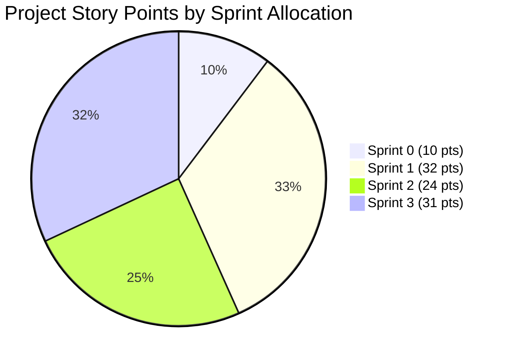

# PortfolioPro — Implementation Status Dashboard

## 1. Executive Status Overview

| Metric | Current Value | Target / Total |
| :--- | :---: | :---: |
| **Current Project Phase** | **Sprint 0: Architecture & Foundation** | Milestone Release v1.0.0 |
| **Overall Implementation Progress** | **3.1% (3 Story Points Burned)** | 100% |
| **Total Epics Completed** | **0 / 12 Epics (In Progress: P15-E01)** | 12 Epics |
| **Total User Stories Completed** | **1 / 37 Stories (P15-US02 Completed)**| 37 User Stories |
| **Total Story Points Burned** | **3 / 97 Points** | 97 Story Points |
| **Deliverables Submitted** | **1 / 17 Deliverables (D03 Completed)**| 17 Deliverables |
| **Target Active Tag** | Sprint 0 Target: `v0.1.0` | `v1.0.0` |

---

## 2. Sprint-by-Sprint Progress

| Sprint | Goal & Focus | Target Tag | Stories | Points | Completed | Status |
| :---: | :--- | :---: | :---: | :---: | :---: | :---: |
| **Sprint 0** | Git Repo, Database Design, Wireframes, Skeleton & RBAC Base | `v0.1.0` | 4 | 10 | 0 | `[PENDING]` |
| **Sprint 1** | Auth, Accounts, Market Data, Trading Engine Core | `v0.2.0` | 12 | 32 | 0 | `[PENDING]` |
| **Sprint 2** | Portfolio Management, Risk Analytics, Technical Indicators | `v0.3.0` | 9 | 24 | 0 | `[PENDING]` |
| **Sprint 3** | Fundamental Analysis, Notifications, Support, QA & Release | `v1.0.0` | 12 | 31 | 0 | `[PENDING]` |
| **Total** | **90 Hours Total Effort Across 4 Sprints** | `v1.0.0` | **37** | **97** | **0** | `[PENDING]` |

---

## 3. Master User Stories Implementation Matrix

Every user story from the HCLTech workbook is tracked below. All items are marked **Pending** as no application code has been built prior to user approval.

| Story ID | Epic ID | Feature Description | Role | Priority | Pts | Sprint | Target Git Branch | Status | Deliverable Ref |
| :--- | :--- | :--- | :---: | :---: | :---: | :---: | :--- | :---: | :---: |
| **P15-US01** | P15-E01 | Git repo, README, .gitignore, develop branch | Dev | Must | 2 | S0 | `feature/P15-US01-repo-setup` | `PENDING` | D01 |
| **P15-US02** | P15-E01 | ER diagram, 3NF schema, Indian seed data | Dev | Must | 3 | S0 | `feature/P15-US02-database-design` | `PENDING` | D03 |
| **P15-US03** | P15-E01 | Wireframes for login, dashboard, order entry | Cust | Must | 2 | S0 | `feature/P15-US03-wireframes-design` | `PENDING` | D02 |
| **P15-US04** | P15-E01 | Skeleton with login & role-based nav (tag v0.1.0) | Dev | Must | 3 | S0 | `feature/P15-US04-project-skeleton` | `PENDING` | D01 |
| **P15-US05** | P15-E02 | Customer Auth: Register, Profile, UI validations | Cust | Must | 3 | S1 | `feature/P15-US05-customer-auth-ui` | `PENDING` | D04 |
| **P15-US06** | P15-E02 | Finance Officer Auth: User tracking & audit | FO | Must | 2 | S1 | `feature/P15-US06-fo-auth-tracking` | `PENDING` | D04 |
| **P15-US07** | P15-E02 | Auth REST APIs, JWT tokens, Pytest tests | Dev | Must | 3 | S1 | `feature/P15-US07-auth-apis-tests` | `PENDING` | D04 |
| **P15-US08** | P15-E03 | Customer Account: Balances, deposit, withdrawal UI | Cust | Must | 3 | S1 | `feature/P15-US08-customer-account-ui` | `PENDING` | D05 |
| **P15-US09** | P15-E03 | Finance Officer Account: Balance & KYC audit | FO | Must | 2 | S1 | `feature/P15-US09-fo-account-audit` | `PENDING` | D05 |
| **P15-US10** | P15-E03 | Account REST APIs, ledger logic, Pytest tests | Dev | Must | 3 | S1 | `feature/P15-US10-account-apis-tests` | `PENDING` | D05 |
| **P15-US11** | P15-E04 | Customer Market Data: Search, quotes, watchlists UI | Cust | Must | 3 | S1 | `feature/P15-US11-customer-market-data` | `PENDING` | D06 |
| **P15-US12** | P15-E04 | Finance Officer Market Data: Feed oversight & audit | FO | Must | 2 | S1 | `feature/P15-US12-fo-market-data-oversight`| `PENDING` | D06 |
| **P15-US13** | P15-E04 | Market Data REST APIs, quote feeder, tests | Dev | Must | 3 | S1 | `feature/P15-US13-market-apis-tests` | `PENDING` | D06 |
| **P15-US14** | P15-E05 | Customer Trading: Order placement & order book UI | Cust | Must | 3 | S1 | `feature/P15-US14-customer-trading-ui` | `PENDING` | D07 |
| **P15-US15** | P15-E05 | Finance Officer Trading: Order book audit & logs | FO | Must | 2 | S1 | `feature/P15-US15-fo-trading-audit` | `PENDING` | D07 |
| **P15-US16** | P15-E05 | Trading Engine APIs, atomic execution, tests | Dev | Must | 3 | S1 | `feature/P15-US16-trading-apis-tests` | `PENDING` | D07 |
| **P15-US17** | P15-E06 | Customer Portfolio: Holdings & P&L display UI | Cust | Must | 3 | S2 | `feature/P15-US17-customer-portfolio-ui` | `PENDING` | D08 |
| **P15-US18** | P15-E06 | Finance Officer Portfolio: AUM & asset audit | FO | Must | 2 | S2 | `feature/P15-US18-fo-portfolio-audit` | `PENDING` | D08 |
| **P15-US19** | P15-E06 | Portfolio REST APIs, weighted avg cost, tests | Dev | Must | 3 | S2 | `feature/P15-US19-portfolio-apis-tests` | `PENDING` | D08 |
| **P15-US20** | P15-E07 | Customer Risk: Risk gauge, Beta, Sharpe, VaR UI | Cust | Must | 3 | S2 | `feature/P15-US20-customer-risk-ui` | `PENDING` | D09 |
| **P15-US21** | P15-E07 | Finance Officer Risk: Systemic exposure dashboard | FO | Must | 2 | S2 | `feature/P15-US21-fo-risk-dashboard` | `PENDING` | D09 |
| **P15-US22** | P15-E07 | Risk Engine APIs, mathematical models, tests | Dev | Must | 3 | S2 | `feature/P15-US22-risk-apis-tests` | `PENDING` | D09 |
| **P15-US23** | P15-E08 | Customer Technical: Candlestick, RSI, MACD UI | Cust | Should| 3 | S2 | `feature/P15-US23-customer-technical-ui` | `PENDING` | D10 |
| **P15-US24** | P15-E08 | Finance Officer Technical: Signal audit console | FO | Should| 2 | S2 | `feature/P15-US24-fo-technical-audit` | `PENDING` | D10 |
| **P15-US25** | P15-E08 | Technical Analysis APIs, indicator logic, tests | Dev | Should| 3 | S2 | `feature/P15-US25-technical-apis-tests` | `PENDING` | D10 |
| **P15-US26** | P15-E09 | Customer Fundamental: Valuation ratios, health UI | Cust | Should| 3 | S3 | `feature/P15-US26-customer-fundamental-ui`| `PENDING` | D11 |
| **P15-US27** | P15-E09 | Finance Officer Fundamental: Financial statements | FO | Should| 2 | S3 | `feature/P15-US27-fo-fundamental-audit` | `PENDING` | D11 |
| **P15-US28** | P15-E09 | Fundamental Analysis APIs, financial ratios, tests| Dev | Should| 3 | S3 | `feature/P15-US28-fundamental-apis-tests` | `PENDING` | D11 |
| **P15-US29** | P15-E10 | Customer Alerts: Price triggers & notifications UI| Cust | Should| 3 | S3 | `feature/P15-US29-customer-alerts-ui` | `PENDING` | D12 |
| **P15-US30** | P15-E10 | Finance Officer Alerts: Broadcast console & audit | FO | Should| 2 | S3 | `feature/P15-US30-fo-notification-audit` | `PENDING` | D12 |
| **P15-US31** | P15-E10 | Notification APIs, alert trigger background worker| Dev | Should| 3 | S3 | `feature/P15-US31-notification-apis-tests` | `PENDING` | D12 |
| **P15-US32** | P15-E11 | Customer Support: Ticket submission & chat UI | Cust | Should| 3 | S3 | `feature/P15-US32-customer-support-ui` | `PENDING` | D13 |
| **P15-US33** | P15-E11 | Finance Officer Support: Helpdesk triage & reply | FO | Should| 2 | S3 | `feature/P15-US33-fo-support-resolution` | `PENDING` | D13 |
| **P15-US34** | P15-E11 | Support APIs, ticket lifecycle logic, Pytest tests| Dev | Should| 3 | S3 | `feature/P15-US34-support-apis-tests` | `PENDING` | D13 |
| **P15-US35** | P15-E12 | End-to-end integration test execution & defect log| QA | Must | 3 | S3 | `feature/P15-US35-qa-test-report` | `PENDING` | D14 |
| **P15-US36** | P15-E12 | Technical docs, OpenAPI Swagger, Postman export | Dev | Must | 2 | S3 | `feature/P15-US36-api-documentation` | `PENDING` | D15 |
| **P15-US37** | P15-E12 | Live demo presentation, develop->main PR, v1.0.0 | Team | Must | 2 | S3 | `feature/P15-US37-release-v1` | `PENDING` | D16, D17 |

---

## 4. Deliverables Tracking Register (D01 – D17)

| ID | Deliverable Title | Target Sprint | Responsible Owner | Primary Artifact Path | Status |
| :---: | :--- | :---: | :---: | :--- | :---: |
| **D01** | Git repository with README & branching | Sprint 0 | Team | `README.md`, `.gitignore`, `git branch` | `PENDING` |
| **D02** | Requirement summary & wireframes | Sprint 0 | Team | `docs/wireframes/`, `REQUIREMENTS.md` | `PENDING` |
| **D03** | Database design, schema & seed scripts | Sprint 0 | Team | `database/schema.sql`, `database/seed_data.sql` | `PENDING` |
| **D04** | Working Module: User Authentication | Sprint 1 | Team | `backend/apps/authentication/`, UI, Tests | `PENDING` |
| **D05** | Working Module: Account Management | Sprint 1 | Team | `backend/apps/accounts/`, UI, Tests | `PENDING` |
| **D06** | Working Module: Market Data | Sprint 1 | Team | `backend/apps/market/`, UI, Tests | `PENDING` |
| **D07** | Working Module: Trading Engine | Sprint 1 | Team | `backend/apps/trading/`, UI, Tests | `PENDING` |
| **D08** | Working Module: Portfolio Management | Sprint 2 | Team | `backend/apps/portfolio/`, UI, Tests | `PENDING` |
| **D09** | Working Module: Risk Management | Sprint 2 | Team | `backend/apps/risk/`, UI, Tests | `PENDING` |
| **D10** | Working Module: Technical Analysis | Sprint 2 | Team | `backend/apps/technical/`, UI, Tests | `PENDING` |
| **D11** | Working Module: Fundamental Analysis | Sprint 3 | Team | `backend/apps/fundamental/`, UI, Tests | `PENDING` |
| **D12** | Working Module: Notification & Alerts | Sprint 3 | Team | `backend/apps/notifications/`, UI, Tests | `PENDING` |
| **D13** | Working Module: Customer Support | Sprint 3 | Team | `backend/apps/support/`, UI, Tests | `PENDING` |
| **D14** | Test Report & Defect Log | Sprint 3 | QA Reviewer | `docs/test-report/TEST_REPORT.md` | `PENDING` |
| **D15** | API Documentation & Setup README | Sprint 3 | Developer | `docs/api/swagger.json`, `README.md` | `PENDING` |
| **D16** | Live Demo & 10-Slide Presentation Deck | Sprint 3 | Team | `docs/presentation/PortfolioPro_Presentation.pdf` | `PENDING` |
| **D17** | Final Tagged Production Release v1.0.0 | Sprint 3 | Team | Git Tag `v1.0.0` on `main` branch | `PENDING` |
