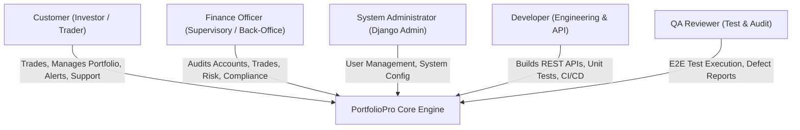
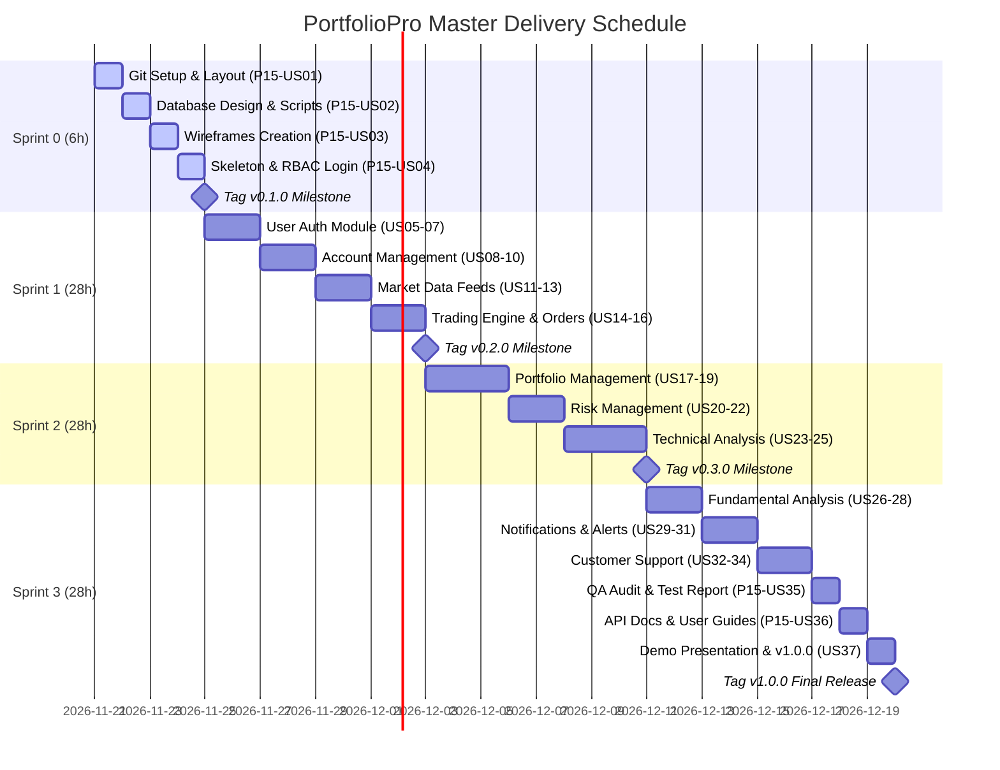

# PortfolioPro — Project Plan & Delivery Roadmap

## 1. Project Identification & Academic Metadata

| Attribute | Specification |
| :--- | :--- |
| **Project Code** | `P15` |
| **Project Title** | **PortfolioPro - Advanced Stock Trading and Portfolio Management Application** |
| **Academic Programme** | ABES Engineering College — MCA 2nd Year (Semester III/IV Major Project) |
| **Skill Track** | Full-Stack Development (FSD) Python |
| **Curriculum Authority**| Program Manager, EdTech, HCLTech |
| **Domain** | Financial Technology (WealthTech / Stock Trading & Portfolio Management) |
| **Target Repository** | `mca2-fsdpython-portfoliopro` |
| **Total Effort** | 90 Clock Hours (Sprint 0: 6h; Sprints 1–3: 28h each) |
| **Total Epics** | 12 Epics (`P15-E01` to `P15-E12`) |
| **Total User Stories** | 37 User Stories (`P15-US01` to `P15-US37`) |
| **Total Story Points** | 97 Story Points (Fibonacci scale: 2, 3) |
| **Total Deliverables** | 17 Formal Deliverables (`D01` to `D17`) |
| **Current Status** | **Pending Approval / Inception Phase Completed** |

---

## 2. Executive Summary & Vision

**PortfolioPro** is an enterprise-grade full-stack financial technology web application designed to bridge the gap between active stock market trading and long-term portfolio wealth management. Tailored specifically for retail investors and financial administrators within the Indian financial context (NSE/BSE equities, INR denominated assets), PortfolioPro enables users to:
1. Conduct real-time market data monitoring and multi-criteria equity screening.
2. Execute simulated paper-trading orders (Market, Limit, Stop-Loss) with ACID-compliant portfolio balance deduction and share settlement.
3. Manage multi-asset portfolios with detailed tracking of unrealized/realized P&L, sector allocation, and investment performance metrics.
4. Evaluate portfolio vulnerability and market risks using automated risk analytics (Beta, Sharpe Ratio, Value at Risk / VaR, diversification metrics).
5. Leverage automated technical indicators (RSI, MACD, SMA/EMA) and fundamental health scoring (P/E, EPS, Debt-to-Equity, Dividend Yield).
6. Configure automated market price alerts and transaction notifications.
7. Access full-cycle customer support and trade dispute resolution via a structured helpdesk ticketing system.
8. Provide back-office supervisory oversight for **Finance Officers** to audit transactions, monitor platform-wide risk exposure, inspect KYC accounts, and review regulatory compliance.

---

## 3. Roles & Stakeholder Governance

The application strictly differentiates permissions across five primary roles:

1. **Customer (Retail Investor / Trader)**:
   - Primary end-user responsible for managing individual trading accounts.
   - Adds funds, searches and monitors tickers, executes buy/sell equity orders, tracks holdings and real-time P&L, sets automated price alerts, and raises customer service tickets.
2. **Finance Officer (Compliance & Brokerage Operations)**:
   - Operational auditor responsible for platform integrity, financial compliance, and supervisory reporting.
   - Monitors customer order logs, inspects fund deposits and account balances, audits platform-wide market risk exposures, verifies corporate actions, and reviews high-priority customer dispute tickets.
3. **Developer**:
   - Engineering persona responsible for backend Django REST Framework APIs, React frontend components, database migrations, unit tests, and OpenAPI/Swagger documentation.
4. **QA Reviewer**:
   - Quality assurance persona responsible for executing end-to-end test scenarios, validating acceptance criteria across all 37 stories, and compiling the formal defect and test report (`D14`).
5. **Team / Project Lead**:
   - Manages Git repository workflow, reviews pull requests, oversees sprint demo presentations, and tags production releases.

---

## 4. Master Sprint Delivery Plan (90 Hours)

The project is executed strictly across four structured iterations: Sprint 0 (Inception & Architecture) followed by three core feature sprints of 28 hours each.

### Detailed Sprint Breakdown

| Sprint | Effort | Target Git Tag | Focus & Epics Covered | Stories Count | Points | Key Deliverables |
| :--- | :--- | :--- | :--- | :---: | :---: | :--- |
| **Sprint 0** | 6 Hours | `v0.1.0` | **Project Setup, Git Workflow and Design** (`P15-E01`) | 4 | 10 | `D01` (Repo, README, .gitignore) `D02` (Requirements & Wireframes) `D03` (Database schema & seed scripts) |
| **Sprint 1** | 28 Hours | `v0.2.0` | **Core Transactional Foundation** • User Authentication (`P15-E02`) • Account Management (`P15-E03`) • Market Data (`P15-E04`) • Trading Engine (`P15-E05`) | 12 | 32 | `D04` (Auth module working & tested) `D05` (Account module working & tested) `D06` (Market Data working & tested) `D07` (Trading Engine working & tested) |
| **Sprint 2** | 28 Hours | `v0.3.0` | **Portfolio & Analytical Engine** • Portfolio Management (`P15-E06`) • Risk Management (`P15-E07`) • Technical Analysis (`P15-E08`) | 9 | 24 | `D08` (Portfolio Mgmt working & tested) `D09` (Risk Mgmt working & tested) `D10` (Technical Analysis working & tested) |
| **Sprint 3** | 28 Hours | `v1.0.0` | **Advanced Insights, Support & Release** • Fundamental Analysis (`P15-E09`) • Notification and Alerts (`P15-E10`) • Customer Support (`P15-E11`) • Testing, Docs & Release (`P15-E12`) | 12 | 31 | `D11` (Fundamental Analysis working) `D12` (Notification/Alerts working) `D13` (Customer Support working) `D14` (QA Test Report & Defect Log) `D15` (API Docs / Swagger & README) `D16` (Demo Presentation & Slides) `D17` (Final Tagged Release v1.0.0) |
| **Total** | **90 Hours** | `v1.0.0` | **12 Epics Completed End-to-End** | **37** | **97** | **All 17 Deliverables** |

---

## 5. Master Deliverables Matrix (D01 – D17)

Every deliverable mandated by the HCLTech workbook is cataloged below with its verification format and sprint due date:

| Deliverable ID | Deliverable Name | Description / Verification Format | Due Sprint | Responsible Owner | Status |
| :--- | :--- | :--- | :---: | :---: | :---: |
| **D01** | Git repository setup | Repository link, `README.md`, `.gitignore`, `develop` branch, folder layout | Sprint 0 | Team | Pending |
| **D02** | Requirement summary & wireframes | Problem statement, user personas, UI wireframes in `docs/wireframes/` | Sprint 0 | Team | Pending |
| **D03** | Database design & scripts | ER diagram, 3NF `database/schema.sql`, and Indian test seed `database/seed_data.sql` | Sprint 0 | Team | Pending |
| **D04** | Module: User Authentication | Fully working Auth feature (UI, JWT API, DB, tests, demo note) | Sprint 1 | Team | Pending |
| **D05** | Module: Account Management | Fully working Account feature (UI, API, DB, tests, demo note) | Sprint 1 | Team | Pending |
| **D06** | Module: Market Data | Fully working Market Data feature (UI, API, DB, tests, demo note) | Sprint 1 | Team | Pending |
| **D07** | Module: Trading Engine | Fully working Trading Engine (UI, API, DB, tests, demo note) | Sprint 1 | Team | Pending |
| **D08** | Module: Portfolio Management | Fully working Portfolio Management (UI, API, DB, tests, demo note) | Sprint 2 | Team | Pending |
| **D09** | Module: Risk Management | Fully working Risk Management (UI, API, DB, tests, demo note) | Sprint 2 | Team | Pending |
| **D10** | Module: Technical Analysis | Fully working Technical Analysis (UI, API, DB, tests, demo note) | Sprint 2 | Team | Pending |
| **D11** | Module: Fundamental Analysis | Fully working Fundamental Analysis (UI, API, DB, tests, demo note) | Sprint 3 | Team | Pending |
| **D12** | Module: Notification & Alerts | Fully working Notification & Alerts (UI, API, DB, tests, demo note) | Sprint 3 | Team | Pending |
| **D13** | Module: Customer Support | Fully working Customer Support (UI, API, DB, tests, demo note) | Sprint 3 | Team | Pending |
| **D14** | Test Report & Defect Log | Detailed test cases, Pytest test execution logs, defect log in `docs/test-report` | Sprint 3 | QA Reviewer | Pending |
| **D15** | API Documentation & Guide | Comprehensive OpenAPI / Swagger documentation (`drf-spectacular`) & setup guide | Sprint 3 | Developer | Pending |
| **D16** | Demo & Presentation | Working live presentation, 10-slide deck in `docs/presentation/`, demo video | Sprint 3 | Team | Pending |
| **D17** | Final Release v1.0.0 | Tagged release `v1.0.0` on `main` branch with clean release notes | Sprint 3 | Team | Pending |

---

## 6. Definition of Done (DoD)

To ensure academic and professional software engineering rigor, each User Story must satisfy the following criteria before being marked as Completed:

1. **Feature Branch Isolation**: Development conducted in isolated branch named `feature/<story-id>-<short-name>` branched from `develop`.
2. **Acceptance Criteria Verification**: All bulleted acceptance criteria outlined in the HCLTech workbook are demonstrably satisfied.
3. **Automated Unit & Integration Tests**: Backend test cases implemented using `pytest` and `pytest-django`; tests pass with zero errors.
4. **Data Integrity & Validations**: Mandatory field checks, type checking, and format validations active both on frontend and backend serializers.
5. **Role-Based Security**: Appropriate view permissions (`IsCustomer`, `IsFinanceOfficer`, or admin restrictions) validated.
6. **Documentation Synchronization**: `README.md`, schema definitions, or API endpoints updated if data models or routes changed.
7. **Peer Review & Clean Merge**: Pull request opened targeting `develop`, reviewed, approved, and merged with conventional commit messages.
8. **Milestone Tagging**: At each sprint conclusion, the designated Git tag (`v0.1.0`, `v0.2.0`, `v0.3.0`, `v1.0.0`) is generated and pushed alongside a sprint review summary in `docs/`.
