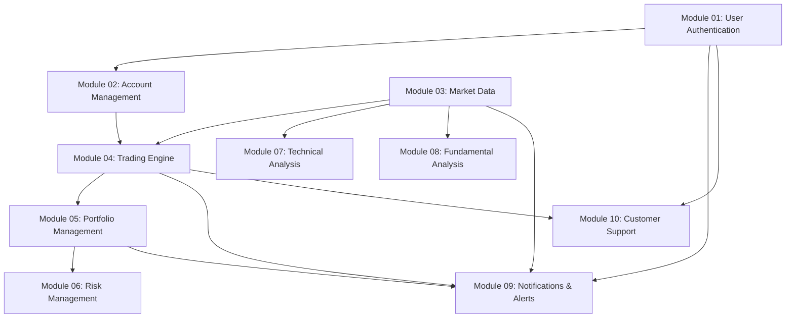

# PortfolioPro — System Requirements Specification (SRS)

## 1. Introduction & Project Scope

### 1.1 Purpose
This document specifies the software requirements for **PortfolioPro - Advanced Stock Trading and Portfolio Management Application** (Project Code: `P15`), an MCA 2nd Year capstone software engineering project under the FSD Python skill track (HCLTech / ABES Engineering College curriculum).

### 1.2 Scope of the Application
PortfolioPro is a multi-tier financial technology web application designed to allow retail investors (**Customers**) to trade equities, monitor market data, manage multi-asset portfolios, assess investment risks, analyze technical and fundamental indicators, receive market alerts, and access customer support. Concurrently, it equips back-office brokerage administrators (**Finance Officers**) with auditing, risk monitoring, transaction tracking, and compliance enforcement capabilities.

---

## 2. User Roles & Permission Matrix

The application strictly implements Role-Based Access Control (RBAC):

| Feature / Domain Area | Customer Role | Finance Officer Role | System Admin |
| :--- | :---: | :---: | :---: |
| **Self Registration & Profile Setup** | Full Access | View / Audit Only | Full Access |
| **KYC Submission & Document Upload** | Create / Update | View / Verify / Reject | Full Access |
| **Account Cash Balance (Deposit/Withdrawal)**| Request / View Own | Approve / Audit All Accounts | Full Access |
| **Market Data Viewing & Search** | Full View Access | Full View Access | CRUD Master Data |
| **Stock Watchlists** | Create / Edit Own | View-Only Audit | Full Access |
| **Order Placement (Buy/Sell Equity)** | Execute Own Orders | View All Orders / Intervene | Full Access |
| **Order Book & Execution History** | View Own Orders | Filter / Export All Orders | Full Access |
| **Portfolio Holdings & Asset Breakdown** | View Own Portfolio | View System-Wide Portfolios | Full Access |
| **Realized & Unrealized P&L Analytics** | View Own P&L | View Aggregate Platform P&L | Full Access |
| **Risk Metrics (Beta, Sharpe, VaR)** | View Own Portfolio Risk | Track High-Risk Accounts / Exposure| Full Access |
| **Technical Indicators (RSI, MACD, SMA)** | View Interactive Charts | View Interactive Charts | Full Access |
| **Fundamental Health Scores (P/E, D/E)**| View Stock Fundamentals | Audit Financial Statements Data | Update Fundamentals |
| **Custom Price Alerts** | Create / Manage Own | Audit Platform Alert Queues | Full Access |
| **Customer Support Helpdesk** | Raise / View Own Tickets| Claim / Resolve / Close Tickets| Reassign Tickets |
| **Audit Logs & Transaction Trail** | None | Read-Only Access | Full Access |

---

## 3. Detailed Functional Requirements by Module

Each requirement is extracted from the official HCLTech curriculum guide, mapped to its respective module, and given a tracking ID. All requirements are currently marked as **Pending**.

```
Status Legend:
- [PENDING] : Requirement specified, architectural design completed, implementation pending.
- [IN PROGRESS] : Implementation underway in dedicated sprint feature branch.
- [COMPLETED] : Acceptance criteria met, unit tests passing, PR merged into develop.
```

---

### Module 01: User Authentication (`P15-E02`)
*Provides secure identity management, token generation, session handling, and role assignment.*

- **REQ-AUTH-01** `[PENDING]`: User Registration endpoint enabling new users to create accounts with email, username, phone number, password, and designated primary role (`Customer` or `Finance Officer`).
- **REQ-AUTH-02** `[PENDING]`: Secure password hashing using PBKDF2 with SHA-256 (or Argon2) as per Django authentication best practices; plain-text passwords must never be stored.
- **REQ-AUTH-03** `[PENDING]`: JWT-based Authentication (JSON Web Tokens via `djangorestframework-simplejwt`) issuing short-lived Access Tokens (e.g., 60 mins) and Refresh Tokens (e.g., 1 day) upon valid credentials.
- **REQ-AUTH-04** `[PENDING]`: Role-based route protection on frontend (React Router guards) and backend (DRF permission classes: `IsAuthenticated`, `IsCustomer`, `IsFinanceOfficer`).
- **REQ-AUTH-05** `[PENDING]`: Customer self-profile view and edit interface with mandatory field validations (phone format, email syntax, unique constraints).
- **REQ-AUTH-06** `[PENDING]`: Finance Officer user management interface allowing filtering, tracking, activation/deactivation, and role inspection of all platform users.

---

### Module 02: Account Management (`P15-E03`)
*Manages trading accounts, KYC compliance, linked bank details, and cash ledger balances.*

- **REQ-ACCT-01** `[PENDING]`: Automatic creation of a default Trading Account for registered Customers with a unique Account Number and currency set to INR (`₹`).
- **REQ-ACCT-02** `[PENDING]`: Customer funds deposit and withdrawal workflow with virtual cash ledger tracking and transaction status (`PENDING`, `COMPLETED`, `REJECTED`).
- **REQ-ACCT-03** `[PENDING]`: Mandatory validation preventing withdrawals exceeding the available unencumbered cash balance.
- **REQ-ACCT-04** `[PENDING]`: Customer KYC information management (PAN card number, Aadhaar number/mask, bank account number, IFSC code).
- **REQ-ACCT-05** `[PENDING]`: Finance Officer supervisory console to inspect customer account balances, review deposit/withdrawal ledgers, filter by account status, and approve/flag suspicious accounts.

---

### Module 03: Market Data (`P15-E04`)
*Maintains stock exchange tickers, equity instruments, historical price bars, and current quotes.*

- **REQ-MKT-01** `[PENDING]`: Master Security Master table storing Indian equities (e.g., RELIANCE, TCS, HDFCBANK, INFY, ICICIBANK, TATASTEEL, SBIN) with ticker symbol, company name, exchange (NSE/BSE), sector, and lot size.
- **REQ-MKT-02** `[PENDING]`: Real-time quote endpoint providing Last Traded Price (LTP), open, high, low, close (OHLC), volume, and 52-week high/low.
- **REQ-MKT-03** `[PENDING]`: Customer ticker search and filter interface with instant search-as-you-type and sector-wise filtering.
- **REQ-MKT-04** `[PENDING]`: Customer customizable Watchlist feature allowing users to pin stocks and view live updates.
- **REQ-MKT-05** `[PENDING]`: Finance Officer supervisory market feed monitor to inspect market data latency, audit quote anomalies, and manage stock listing statuses.

---

### Module 04: Trading Engine (`P15-E05`)
*Validates, executes, and records equity order placements with strict transactional guarantees.*

- **REQ-TRD-01** `[PENDING]`: Order placement supporting `BUY` and `SELL` transactions across order types: `MARKET` and `LIMIT`.
- **REQ-TRD-02** `[PENDING]`: Pre-trade risk & fund check: Buy orders must atomatically verify that `available_balance >= (quantity * price) + brokerage_fees`; Sell orders must verify that `portfolio_holdings >= quantity`.
- **REQ-TRD-03** `[PENDING]`: Atomic Execution Engine using Django `transaction.atomic()`: Upon execution, deduct/credit cash balance, update/create portfolio holding record, and create an immutable trade execution record.
- **REQ-TRD-04** `[PENDING]`: Customer interactive order placement interface with live cost estimator, lot validation, and order confirmation modal.
- **REQ-TRD-05** `[PENDING]`: Customer order book displaying active, completed, and cancelled orders with status indicators.
- **REQ-TRD-06** `[PENDING]`: Finance Officer system-wide order audit log displaying all platform trades, with filtering by date range, ticker, customer ID, order type, and execution status.

---

### Module 05: Portfolio Management (`P15-E06`)
*Computes aggregate portfolio valuations, asset weights, realized/unrealized profit & loss.*

- **REQ-PORT-01** `[PENDING]`: Real-time position tracking showing stock symbol, total quantity held, average purchase price, current market price (CMP), total current value, and day change.
- **REQ-PORT-02** `[PENDING]`: Accurate P&L calculation:
  - Unrealized P&L = `(CMP - Avg_Buy_Price) * Quantity`
  - Percentage Return = `((CMP - Avg_Buy_Price) / Avg_Buy_Price) * 100`
  - Realized P&L tracked across closed positions.
- **REQ-PORT-03** `[PENDING]`: Interactive asset allocation and sector diversification breakdown displayed using visual charts (e.g. pie/doughnut charts for sector exposure).
- **REQ-PORT-04** `[PENDING]`: Customer historical performance timeline tracking total portfolio equity curve over time.
- **REQ-PORT-05** `[PENDING]`: Finance Officer portfolio audit view allowing inspection of customer wealth distributions, exposure to specific equities, and margin balances.

---

### Module 06: Risk Management (`P15-E07`)
*Calculates portfolio volatility, concentration risk, and regulatory risk metrics.*

- **REQ-RISK-01** `[PENDING]`: Portfolio Beta calculation measuring customer portfolio sensitivity relative to the benchmark index (NIFTY 50).
- **REQ-RISK-02** `[PENDING]`: Sharpe Ratio calculation evaluating risk-adjusted return relative to the risk-free rate (assumed 6.5% for Indian Sovereign T-Bills).
- **REQ-RISK-03** `[PENDING]`: Value at Risk (VaR 95%) metric estimating the maximum potential monetary loss over a 1-day / 1-month horizon.
- **REQ-RISK-04** `[PENDING]`: Concentration Risk warning indicator triggered when an individual stock holding exceeds 25% of total portfolio value.
- **REQ-RISK-05** `[PENDING]`: Finance Officer Risk Dashboard highlighting accounts with excessive concentration, severe drawdowns, or margin liquidation vulnerabilities.

---

### Module 07: Technical Analysis (`P15-E08`)
*Generates technical indicators and interactive price charting to inform trading decisions.*

- **REQ-TECH-01** `[PENDING]`: Interactive candlestick and line charts rendering historical OHLCV data across daily and weekly intervals.
- **REQ-TECH-02** `[PENDING]`: Relative Strength Index (RSI - 14 period) calculation with overbought (>70) and oversold (<30) visualization levels.
- **REQ-TECH-03** `[PENDING]`: Moving Average Convergence Divergence (MACD 12, 26, 9) indicator calculating MACD line, signal line, and histogram.
- **REQ-TECH-04** `[PENDING]`: Simple Moving Average (SMA - 20, 50, 200 days) and Exponential Moving Average (EMA) overlays on charts.
- **REQ-TECH-05** `[PENDING]`: Technical summary indicator generating an automated signal badge (`Strong Buy`, `Buy`, `Neutral`, `Sell`, `Strong Sell`) based on indicator consensus.
- **REQ-TECH-06** `[PENDING]`: Finance Officer audit view to review technical signal integrity and market indicator calculation health.

---

### Module 08: Fundamental Analysis (`P15-E09`)
*Provides corporate financial metrics, valuation ratios, and financial statement summaries.*

- **REQ-FUND-01** `[PENDING]`: Fundamental financial metrics display for each listed equity: Price-to-Earnings (P/E), Price-to-Book (P/B), Earnings Per Share (EPS), Dividend Yield, Return on Equity (ROE), and Debt-to-Equity (D/E).
- **REQ-FUND-02** `[PENDING]`: Corporate financial health score computed from solvency, profitability, and valuation metrics (e.g. 1 to 10 scale).
- **REQ-FUND-03** `[PENDING]`: Peer comparison table comparing a selected stock against sector competitors on key valuation metrics.
- **REQ-FUND-04** `[PENDING]`: Annual and quarterly revenue/profit trends presented in tabular and graphical formats.
- **REQ-FUND-05** `[PENDING]`: Finance Officer fundamental data management interface to audit, verify, and update corporate earnings records.

---

### Module 09: Notification and Alerts (`P15-E10`)
*Provides threshold-triggered price alerts, execution notifications, and system bulletins.*

- **REQ-NOTIF-01** `[PENDING]`: Customer price alert configuration enabling triggers when a stock price reaches Above, Below, or Changes by X% from a target value.
- **REQ-NOTIF-02** `[PENDING]`: Automated background evaluation engine matching incoming price updates against active customer alert conditions.
- **REQ-NOTIF-03** `[PENDING]`: Transactional notifications generated automatically upon order placement, partial fill, complete execution, or order cancellation.
- **REQ-NOTIF-04** `[PENDING]`: In-app notification center with unread counters, mark-as-read, and dismissal controls.
- **REQ-NOTIF-05** `[PENDING]`: Finance Officer broadcast notification console enabling platform-wide announcements (market holiday notices, regulatory margin updates, maintenance alerts).

---

### Module 10: Customer Support (`P15-E11`)
*Facilitates end-to-end customer service, query ticketing, and dispute resolution.*

- **REQ-SUPP-01** `[PENDING]`: Customer support ticket creation with category selection (`Trade Dispute`, `Deposit/Withdrawal Issue`, `Account/KYC`, `Technical Glitch`, `General Inquiry`), priority flag (`Low`, `Medium`, `High`, `Urgent`), subject, and description.
- **REQ-SUPP-02** `[PENDING]`: Interactive ticket message thread allowing back-and-forth communication between the Customer and Support / Finance Officer.
- **REQ-SUPP-03** `[PENDING]`: Support ticket lifecycle tracking across states: `OPEN`, `IN_PROGRESS`, `PENDING_CUSTOMER`, `RESOLVED`, `CLOSED`.
- **REQ-SUPP-04** `[PENDING]`: Finance Officer helpdesk dashboard to view ticket queues, filter by category/priority, assign tickets, reply to customers, and resolve disputes.
- **REQ-SUPP-05** `[PENDING]`: SLA tracking and resolution timestamps recorded for quality auditing.

---

## 4. Non-Functional Requirements (NFR)

### 4.1 Security & Authentication
- **NFR-SEC-01**: Passwords must be hashed using Django's default PBKDF2 with SHA-256 algorithm (minimum 320,000 iterations) or Argon2. Passwords must meet complexity requirements (min 8 chars, alphanumeric + symbol).
- **NFR-SEC-02**: All protected API endpoints must enforce JWT token verification with appropriate authorization checks based on user claims.
- **NFR-SEC-03**: Cross-Origin Resource Sharing (CORS) must be restricted to verified frontend domains (`localhost:5173` in development, Netlify production URL in deployment).
- **NFR-SEC-04**: Protection against SQL Injection via strict utilization of Django ORM parameterized queries; raw SQL queries are prohibited unless sanitized with parameters.
- **NFR-SEC-05**: Cross-Site Scripting (XSS) and Cross-Site Request Forgery (CSRF) defenses enforced via React DOM sanitization and Django security middleware.
- **NFR-SEC-06**: Zero hardcoded secrets: Secret keys, database connection strings, and JWT signing keys must be loaded exclusively via environment variables (`.env`).

### 4.2 Performance & Scalability
- **NFR-PERF-01**: Sub-500ms response time for standard REST read/write endpoints under normal concurrent user loads.
- **NFR-PERF-02**: Database queries must use B-Tree indexing on all foreign keys (`user_id`, `account_id`, `security_id`) and frequently filtered fields (`symbol`, `order_status`, `created_at`).
- **NFR-PERF-03**: Standardized pagination (`PageNumberPagination` with page size 10 to 50) on all collection endpoints (Order book, Trade logs, Market ticks, Notifications, Support tickets).

### 4.3 Data Integrity & Transactional Consistency
- **NFR-DATA-01**: Financial order execution, fund balance deduction, and portfolio holding updates must execute within an atomic transaction block (`@transaction.atomic`). Failure at any step must perform a complete rollback.
- **NFR-DATA-02**: Currency and prices must use `DECIMAL(18, 4)` in PostgreSQL and Python `Decimal` objects; floating-point (`float`) arithmetic is strictly prohibited for monetary calculations.
- **NFR-DATA-03**: Third Normal Form (3NF) compliance across all relational tables with foreign key referential integrity constraints (`ON DELETE CASCADE` or `ON DELETE PROTECT`).

### 4.4 Usability & Cross-Platform Accessibility
- **NFR-UI-01**: Fully responsive user interface built with Bootstrap 5 supporting screen resolutions from 360px mobile viewports up to 4K desktop displays.
- **NFR-UI-02**: Monetary values formatted in Indian Rupee format (`₹ xx,xx,xxx.xx`) adhering to the Indian numbering system.
- **NFR-UI-03**: Accessible color contrast and intuitive status indicators (Green for Profit/Buy, Red for Loss/Sell, Amber for Pending).

---

## 5. Module Dependency Analysis

The architectural dependencies between the 10 core modules and foundational layers are mapped below:



### Dependency Explanations:
1. **Module 01 (Auth) is the root prerequisite** for all personalized modules (Account, Trading, Portfolio, Risk, Notifications, Support).
2. **Module 02 (Account) & Module 03 (Market Data) are prerequisites for Module 04 (Trading Engine)**: Orders require validated cash balances (Account) and verified instrument tickers and prices (Market Data).
3. **Module 04 (Trading Engine) feeds Module 05 (Portfolio Management)**: Executed trades update position quantities and cost bases.
4. **Module 05 (Portfolio) feeds Module 06 (Risk Management)**: Risk metrics (Beta, Sharpe, VaR) evaluate the active holdings and equity curves generated by Portfolio Management.
5. **Module 03 (Market Data) feeds Module 07 (Technical) & Module 08 (Fundamental)**: Historical prices feed indicators (RSI, MACD, SMA), while equity records link to fundamental ratios.
6. **Module 09 (Notifications) monitors Module 03 (Prices) and Module 04 (Trades)**: Triggering alerts when price conditions or execution events occur.
7. **Module 10 (Customer Support) cross-references Module 02 (Accounts) and Module 04 (Trades)**: Enabling dispute linkage to specific trade IDs.

---

## 6. Documented Ambiguities & Missing Requirements

The following ambiguities and omissions exist in the HCLTech academic guides (`guide_portfolioHCL.pdf` and `guide2HCL.pdf`). As instructed, **no requirements are invented**; instead, they are recorded below with proposed options for user confirmation:

### 1. Generic User Story Templates for Functional Modules
* **Finding**: In `guide2HCL.pdf`, user stories for Customer and Finance Officer across Modules 02 through 11 repeat the exact identical boilerplate:
  - Customer: *"As a Customer, I want to add, view, update and search records for [module name] so that the work can be done digitally and accurately."*
  - Finance Officer: *"As a Finance Officer, I want to view, filter and track [module name] information so that I can take timely decisions."*
* **Ambiguity**: In real stock trading, Customers do not "add, view, update, and search records for Market Data" (the exchange provides quotes) or "update records for Trading Engine" (orders execute immutably).
* **Architectural Decision Needed**: Clarify that for Customer, "add/update" translates into contextual actions (e.g., in Trading Engine = Place/Cancel Order; in Market Data = Add/Remove Watchlist items; in Technical Analysis = Save Chart Indicator configurations; in Notifications = Create/Edit Price Alert thresholds; in Support = Submit/Update Support Tickets).

### 2. Market Data Feed Origin
* **Finding**: The guide requires "real-time market data and insights" and seed data with Indian tickers (dates 2024–2026), but does not specify if an external API (such as Yahoo Finance / Alpha Vantage / Finnhub) or an internal database-driven market simulation generator is preferred.
* **Architectural Decision Needed**: Should we implement a background simulation service that generates realistic intraday price fluctuations based on seeded NSE/BSE stock data, or integrate a live external API (with fallback simulation for offline/rate-limited environments)?

### 3. Payment Gateway Integration vs. Virtual Cash Ledger
* **Finding**: The guide references adding funds and balance tracking in Account Management, but does not mandate a third-party payment gateway (e.g., Razorpay / Stripe).
* **Architectural Decision Needed**: Confirm that a high-fidelity virtual cash ledger (instant mock deposit/withdrawal with transaction records) fulfills academic requirements without requiring external bank webhooks.

### 4. Technical and Fundamental Analysis Scope
* **Finding**: The guide lists Technical and Fundamental Analysis as distinct modules (Epics `P15-E08` and `P15-E09`), but does not enumerate exact indicators or formulas.
* **Architectural Decision Needed**: Standardize on standard financial industry benchmarks:
  - Technical: RSI (14), MACD (12, 26, 9), SMA (20, 50, 200), EMA (20), and 52-week High/Low.
  - Fundamental: P/E, P/B, EPS, ROE, Debt-to-Equity, Dividend Yield, and Market Cap.
